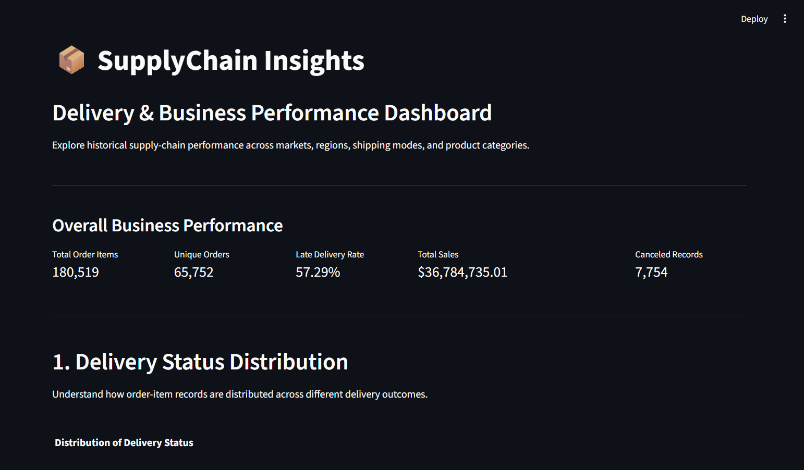
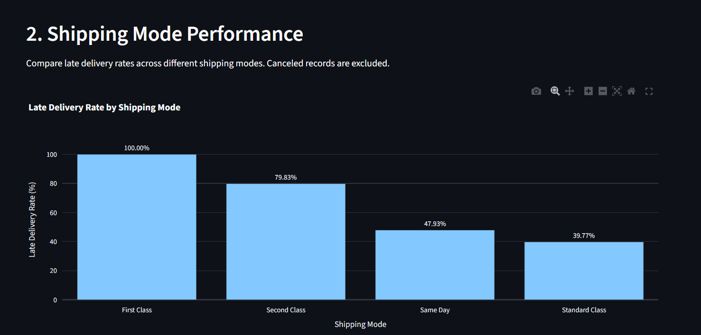
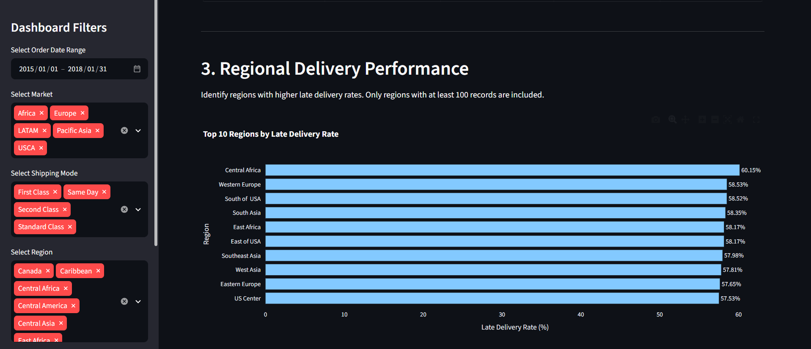

# 📦 SupplyChain Insights
### Supply Chain Delivery Performance & Business Analytics

An end-to-end Data Analytics project focused on analyzing supply-chain delivery performance, identifying operational patterns, and generating actionable business insights using Python, SQL, and an interactive Streamlit dashboard.

---

## 📌 1. Project Overview

SupplyChain Insights is a data analytics project built using the DataCo Smart Supply Chain dataset.

The project investigates historical supply-chain operations to understand delivery delays, compare shipping modes, evaluate regional performance, analyze product categories, and examine the sales value associated with late deliveries.

The project follows an end-to-end analytics workflow, starting with data understanding and cleaning, followed by exploratory data analysis, SQL-based analysis, interactive dashboard development, and business recommendations.

**The primary objective is to turn raw supply-chain data into meaningful business insights that can support operational decision-making.**

## 🎯 2. Business Problem

Late deliveries can affect customer satisfaction, operational efficiency, and business performance.

The project investigates the following business questions:

- What percentage of order-item records are delivered late?
- Which shipping modes experience the highest late delivery rates?
- Which geographical regions contribute the most late deliveries?
- Which product categories have relatively high delivery delay rates?
- How does delivery performance change over time?
- How much sales value is associated with late delivery records?
- What operational improvements should management investigate?

## 🎯 3. Project Objectives

1. Understand the structure and quality of the supply-chain dataset.
2. Clean and preprocess the raw data for reliable analysis.
3. Perform exploratory data analysis to identify trends and patterns.
4. Use SQL to answer business-related analytical questions.
5. Develop an interactive dashboard using Streamlit and Plotly.
6. Identify important business findings and provide recommendations.
7. Present the complete analysis in a structured and reproducible format.

## 📊 4. Dataset Information

**Dataset:** DataCo Smart Supply Chain Dataset

**Source:** [Kaggle – DataCo Smart Supply Chain for Big Data Analysis](https://www.kaggle.com/datasets/shashwatwork/dataco-smart-supply-chain-for-big-data-analysis)

### Dataset Overview

| Attribute | Value |
|---|---:|
| Total records | 180,519 |
| Original columns | 53 |
| Unique orders | 65,752 |
| Unique customers | 20,652 |
| Analysis period | January 2015 – January 2018 |

Each row represents an order-item record. An order may contain multiple items, so the number of records is different from the number of unique orders.

The analysis primarily uses the main supply-chain dataset. The accompanying description file is used as a reference for understanding dataset fields.

## 🛠️ 5. Technology Stack

| Technology | Purpose |
|---|---|
| Python | Data analysis and preprocessing |
| Pandas | Data manipulation and cleaning |
| NumPy | Numerical operations |
| Jupyter Notebook | Exploratory analysis |
| SQL | Business queries and analysis |
| SQLite | Relational database |
| Plotly | Interactive visualizations |
| Streamlit | Interactive dashboard |
| Git & GitHub | Version control and project sharing |

## 🔄 6. Project Workflow

### Phase 1 – Data Understanding

- Loaded and explored the raw dataset.
- Examined rows, columns, and data types.
- Identified missing values and duplicate records.
- Examined delivery status and shipping modes.
- Identified the order-item-level structure of the dataset.

### Phase 2 – Data Cleaning

- Investigated missing and irrelevant fields.
- Removed unsuitable columns from the analytical dataset.
- Converted date fields into appropriate datetime formats.
- Checked duplicate records and data consistency.
- Created a shipping delay feature using actual and scheduled shipping days.
- Investigated discrepancies between supplied shipping-day values and timestamp-derived durations.

### Phase 3 – Exploratory Data Analysis (EDA)

Performed analysis across:

- Overall delivery status distribution.
- Shipping mode performance.
- Regional delivery performance.
- Product category performance.
- Monthly delivery trends.
- Sales and profitability metrics.
- Market-level performance.
- Financial exposure associated with late records.

### Phase 4 – SQL Analysis

Created an SQLite database and performed SQL-based analysis to investigate:

- Overall business KPIs.
- Delivery status distribution.
- Late delivery rates excluding canceled records.
- Shipping mode performance.
- Regional and category-level performance.
- Monthly delivery trends.
- Order status and delivery status relationships.
- Sales and profit metrics.
- Financial exposure from late delivery records.
- Market and region comparisons.

A collection of 15 analytical SQL queries was developed.

### Phase 5 – Interactive Dashboard

Developed an interactive dashboard using Streamlit and Plotly.

Dashboard features include:

- Order date range filtering.
- Market filtering.
- Shipping mode filtering.
- Region filtering.
- Product category filtering.
- Overall business KPIs.
- Delivery status distribution.
- Shipping mode comparison.
- Regional delivery performance.
- Product category performance.
- Monthly late delivery trends.
- Sales by product category.
- Financial exposure analysis.
- Market-level delivery performance.
- Filtered data exploration and CSV download.

### Phase 6 – Business Insights & Recommendations

Prepared a business insights report based on the results of the analysis.

The report includes:

- Executive summary.
- Business problem statement.
- Delivery performance findings.
- Shipping mode and regional analysis.
- Product category and market analysis.
- Financial exposure.
- Business recommendations.
- Analytical limitations.
- Conclusion.

## 📈 7. Key Business Findings

### Overall Delivery Performance

| Metric | Result |
|---|---:|
| Total order-item records | 180,519 |
| Unique orders | 65,752 |
| Late delivery records | 98,977 |
| Non-canceled records | 172,765 |
| Late delivery rate | 57.29% |
| Canceled records | 7,754 |
| Cancellation rate | 4.30% |
| Total sales | $36,784,735.01 |

The late delivery rate is calculated using non-canceled records as the denominator.

### Shipping Mode Performance

| Shipping Mode | Late Delivery Rate |
|---|---:|
| First Class | 100.00% |
| Second Class | 79.83% |
| Same Day | 47.93% |
| Standard Class | 39.77% |

First Class and Second Class show particularly high late delivery rates and deserve further operational investigation.

### Regional Performance

- Central Africa recorded the highest regional late delivery rate at 60.15%.
- Central America contributed the highest late delivery count, with 15,518 records.
- Canada recorded a late delivery rate of 51.60%.

### Product Category Performance

Categories with relatively high late delivery rates include:

- Golf Bags & Carts – 68.85%
- Lacrosse – 62.61%
- Pet Supplies – 61.44%
- Cameras – 61.21%

Small sample sizes should be considered when interpreting category rankings.

### Financial Exposure

| Metric | Amount |
|---|---:|
| Total sales | $36,784,735.01 |
| Sales associated with late records | $20,126,395.27 |
| Order-item value associated with late records | $18,082,555.30 |

These figures represent sales and item value associated with late delivery records, not confirmed financial losses.

## 💡 8. Business Recommendations

Based on the analysis, the following actions are recommended for further investigation:

1. **Review First Class and Second Class delivery commitments:** Investigate the difference between scheduled and actual shipping durations.
2. **Investigate regional performance:** Prioritize Central Africa based on its late rate and Central America based on its late volume.
3. **Prioritize product categories:** Consider late delivery rates alongside record volumes and sales values.
4. **Monitor delivery performance:** Track late delivery rates, shipping delays, and cancellation rates regularly.
5. **Measure actual financial impact:** Combine delivery records with refunds, compensation, logistics expenses, and customer-retention data.

## 🖥️ 9. Interactive Dashboard

The project includes an interactive Streamlit dashboard that allows users to explore supply-chain delivery performance through filters, KPIs, charts, and detailed records.

**Dashboard capabilities:**

- Interactive filters.
- Dynamic KPI calculations.
- Delivery status visualizations.
- Shipping mode and regional comparisons.
- Product category and sales analysis.
- Monthly performance trends.
- Filtered CSV export.

### Dashboard Preview

Add your actual dashboard screenshots in the `reports/screenshots/` folder and update the image paths below.

**Overall Dashboard**



**Shipping Mode Performance**



**Regional Delivery Performance**



## 📁 10. Project Structure

```text
supply-chain-analytics/
│
├── data/
│   ├── raw/
│   └── processed/
│
├── notebooks/
│   ├── 01_data_understanding.ipynb
│   ├── 02_data_cleaning.ipynb
│   └── 03_exploratory_analysis.ipynb
│
├── sql/
│   ├── schema.sql
│   └── analysis_queries.sql
│
├── dashboard/
│   └── app.py
│
├── reports/
│   ├── business_insights.md
│   └── screenshots/
│
├── requirements.txt
├── .gitignore
└── README.md
```

## ⚙️ 11. Installation and Setup

Follow these steps to run the project locally.

### Step 1: Clone the Repository

```bash
git clone YOUR_GITHUB_REPOSITORY_URL
```

Replace the placeholder with the actual repository URL.

### Step 2: Navigate to the Project Folder

```bash
cd supply-chain-analytics
```

### Step 3: Create a Virtual Environment

```bash
python -m venv .venv
```

Activate it on Windows:

```bash
.venv\Scripts\activate
```

### Step 4: Install Dependencies

```bash
pip install -r requirements.txt
```

### Step 5: Prepare the Dataset and Database

Download the DataCo Smart Supply Chain dataset from Kaggle.

Place the required raw dataset in:

```text
data/raw/
```

Prepare the cleaned dataset and SQLite database using the project's data preparation and SQL workflow.

The dashboard expects the database at:

```text
data/processed/supply_chain.db
```

The database must contain a table named:

```text
supply_chain
```

### Step 6: Run the Dashboard

```bash
streamlit run dashboard/app.py
```

The dashboard will open in your browser, normally at:

```text
http://localhost:8501
```

## ⚠️ 12. Limitations

- The dataset contains historical records from January 2015 to January 2018.
- Each row represents an order item rather than a unique order.
- Some dataset fields contain missing values.
- The dataset does not provide sufficient detail to identify the exact operational causes of delivery delays.
- Observed relationships do not establish causation.
- Sales associated with late records should not be interpreted as actual financial losses.
- Small sample sizes can affect the reliability of some regional and product category comparisons.

## 🚀 13. Future Improvements

Potential extensions to this project include:

- Deploying the Streamlit dashboard.
- Integrating additional logistics and carrier datasets.
- Investigating warehouse-level delivery performance.
- Adding customer satisfaction and refund information.
- Developing delivery delay prediction models.
- Building automated performance monitoring.
- Adding more detailed operational and financial KPIs.

## 👨‍💻 14. Author

**Rohan Arora**

B.Tech – Computer Science and Engineering (Cybersecurity)

Interested in Data Analytics, Python, SQL, Cybersecurity, and Business Intelligence.

---

## 📌 Project Summary

SupplyChain Insights demonstrates an end-to-end data analytics workflow using Python, SQL, and Streamlit.

It transforms raw supply-chain records into structured analysis, interactive visualizations, and business recommendations to help investigate delivery performance and operational efficiency.

**Tools:** Python | Pandas | SQL | SQLite | Plotly | Streamlit
